# 10mg Lending Core

One backend that lets many licensed lenders offer **10mg Credit** under their own brand to
pharmacies and clinics. 10mg Credit is checkout financing: when a pharmacy buys stock, the
lender pays the supplier at disbursement and the pharmacy repays the lender later. Each lender
(a "tenant") is isolated from the others inside the database itself. Every movement of money is
a balanced double-entry ledger record and can never be applied twice. Each lender's data stays
in the AWS region its regulator requires.

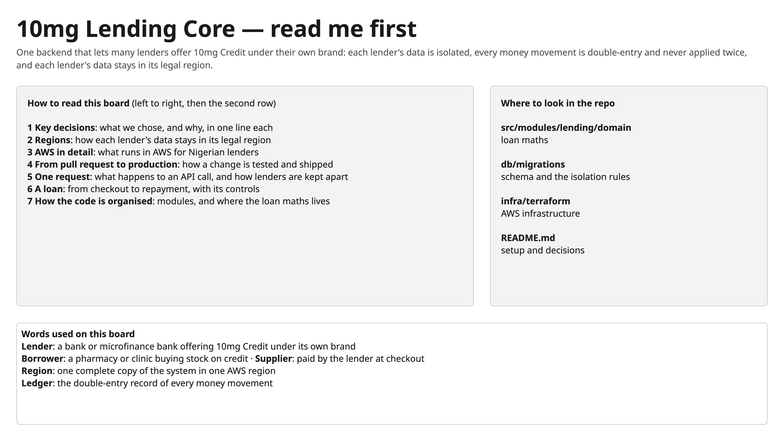

The diagrams in this README are exported from the architecture board in Miro
(<https://miro.com/app/board/uXjVEQk5RNg=/>). Each one has a text (Mermaid) version underneath
that you can expand.

---

## What it does

| Area                      | What you get                                                               | How                                                                                                                                                                                                                            |
| ------------------------- | -------------------------------------------------------------------------- | ------------------------------------------------------------------------------------------------------------------------------------------------------------------------------------------------------------------------------ |
| Multi-tenancy & RBAC      | Many lenders on one deployment; staff roles and borrower logins per lender | PostgreSQL Row-Level Security (RLS) on every tenant table; tenant id taken only from the signed token; one permission map (`src/common/auth/permissions.ts`) checked by a deny-by-default `AuthGuard`                          |
| White-label configuration | Each lender has its own brand, products, webhooks and rate cap             | Branding (name, colours, logo, contacts, locale) via `/v1/institution/branding`, public read at `/v1/institutions/{slug}/branding` (Redis-cached); versioned loan products; per-lender webhook endpoints; platform-set APR cap |
| Lending workflow          | Apply → assess → approve/reject → disburse → repay → close                 | Explicit state machines (`src/modules/lending/domain/state-machines.ts`); explainable mock credit scorecard; repayment schedules, APR and payoff quotes; end-of-day job                                                        |
| Financial integrity       | Money is never lost, invented or applied twice                             | Integer minor units; database-enforced balanced journal entries; `Idempotency-Key` stored in the same transaction as the business write; hash-chained audit log; transactional outbox                                          |
| Code quality              | Readable, tested, reproducible                                             | NestJS modules with a pure lending domain; strict TypeScript; Vitest unit/db/e2e projects with coverage gates; CI lint, typecheck, audit and image scans; Terraform with tests                                                 |

---

## Quick start

**Prerequisites:** Docker (with Compose), Node.js 24, `make`.

```bash
cp .env.example .env        # local-only values; `make up` also does this
npm ci                      # the seed runs on the host
make up                     # postgres, redis, localstack, migrations, API, worker; waits until healthy
make seed                   # demo lenders, staff, products and borrowers in the Lagos cell
```

- API: <http://localhost:3000> (readiness at `/health/ready`).
- Swagger UI: <http://localhost:3000/docs>. The OpenAPI document is committed at
  `openapi/openapi.json` (`make openapi` regenerates it, `make openapi-check` fails if stale).
- `make help` lists every target. `make down` stops the stack; `make clean` also deletes data.

**Demo logins.** `make seed` prints a table of every account it created (lender, role, email,
password). Staff emails follow `admin|credit|finance|audit@<lender-slug>.example`. Passwords come
from the `SEED_*` variables in your `.env`, or are generated and printed when those are empty.
Platform admin: `SEED_PLATFORM_ADMIN_EMAIL`.

**Demo applicants.** The mock credit bureau scores a national id through the tenant's keyed
HMAC, so outcomes differ per lender and per database. The seed therefore also prints, per
lender, sign-up profiles with a known decision for the checkout product (3 APPROVE, 1
COUNTER_OFFER, 1 DECLINE, computed with the real bureau and scorecard) and writes them to
`clients/white-label-web/demo-brands/demo-applicants.json` (override with
`SEED_DEMO_APPLICANTS_FILE`). Each national id can sign up once per lender.

**Two regions locally.** `make demo-cells` starts a second cell (eu-west-3) on port 3001, seeds
both cells, prints the tenant directory and shows an EU-cell login for a Lagos lender answered
with `307` to the Lagos cell.

| Demo lender         | Slug                  | Country | Home cell  |
| ------------------- | --------------------- | ------- | ---------- |
| Eko MediCredit      | `eko-medicredit`      | NG      | af-south-1 |
| Arewa PharmaFinance | `arewa-pharmafinance` | NG      | af-south-1 |
| Delta CareLend      | `delta-carelend`      | NG      | af-south-1 |
| Teranga Santé       | `teranga-sante`       | SN      | eu-west-3  |

The catalogue is `clients/white-label-web/demo-brands/lenders.json` (fictional brands).

**White-label web client** (`clients/white-label-web`, React + Vite):

```bash
cd clients/white-label-web
npm ci
npm run dev                 # http://localhost:5173, proxies /cell/af-south-1 → :3000 and /cell/eu-west-3 → :3001
```

- `/l/<slug>` is the borrower (pharmacy) app for one lender; `/l/<slug>/admin` is that lender's
  back office (applications, loans, ledger, audit).
- `npm test` runs the component tests; `npm run e2e` runs the Playwright journey against the
  local stack.

---

## Architecture

### System context (one region)

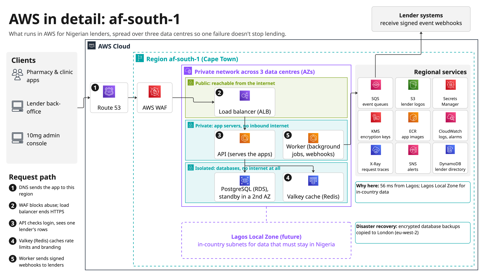

One container image runs as two processes, the **API** and the **worker**. A one-off Flyway
task applies migrations before they roll out.

<details>
<summary>Text version (Mermaid)</summary>

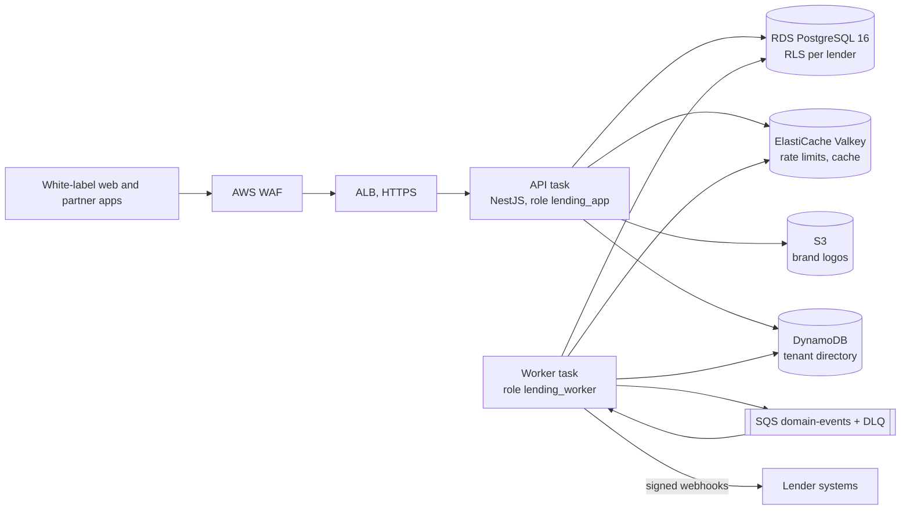

</details>

### Regions and routing

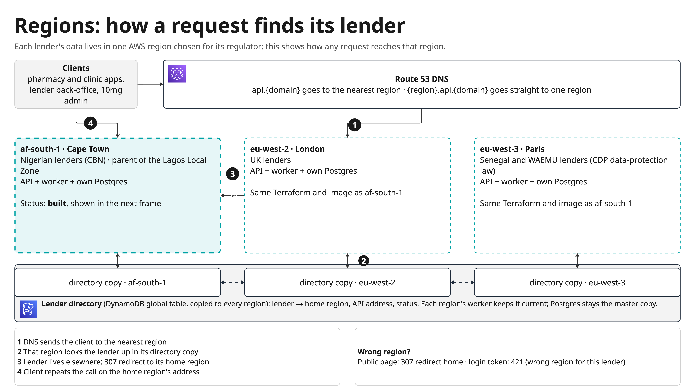

A **cell** is one full copy of the system in one AWS region. Each lender has a fixed
`home_region` and lives in exactly one cell. The only global piece is the tenant directory
(slug → home cell), which holds routing data only.

<details>
<summary>Text version (Mermaid)</summary>

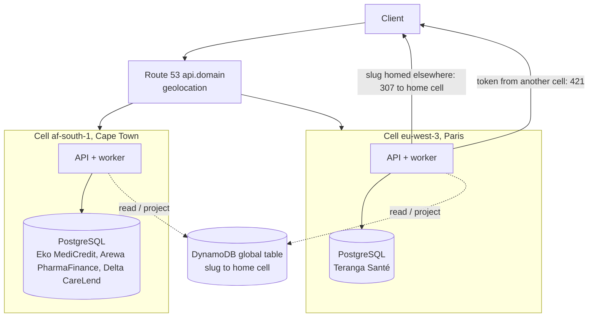

</details>

- **307 Temporary Redirect** on slug-addressed public routes (login, sign-up, public branding)
  when the slug lives in another cell. Method and body are kept. Unknown slugs get the normal local answer, so
  a cell never reveals which slugs exist elsewhere
  (`src/modules/directory/interface/http/cell-routing.middleware.ts`).
- **421 Misdirected Request** when an access token issued by another cell (`cell` claim) is
  presented here; the problem body names the home region (`src/common/auth/auth.guard.ts`).
- Redirects go only to origins listed in `CELL_ORIGINS`.
- The worker projects `institution.*` outbox events into the directory and a reconciler
  repairs drift (`src/worker/directory-reconcile.job.ts`).
- A cell refuses to register a lender homed elsewhere (`422 WRONG_CELL`,
  `src/modules/platform/institutions/register-institution.use-case.ts`).

### One money-moving request

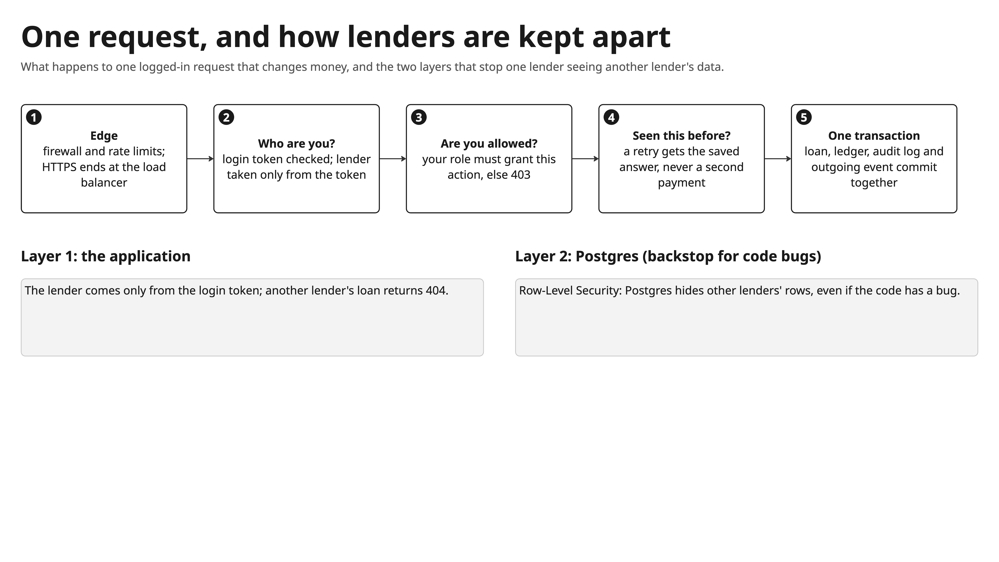

Example: `POST /v1/loans/{id}/disburse`. Every write in the request commits together or not at
all.

<details>
<summary>Text version (Mermaid)</summary>

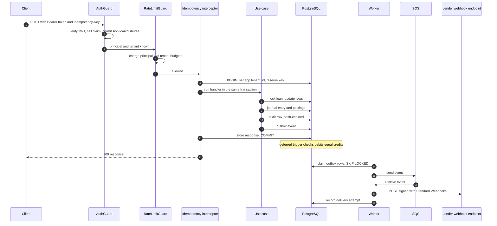

</details>

A retry with the same key and body replays the stored response with
`Idempotent-Replayed: true`. The same key with a different body gets
`422 IDEMPOTENCY_KEY_REUSED`. A concurrent duplicate waits on the key's unique index, then
replays.

### Loan lifecycle

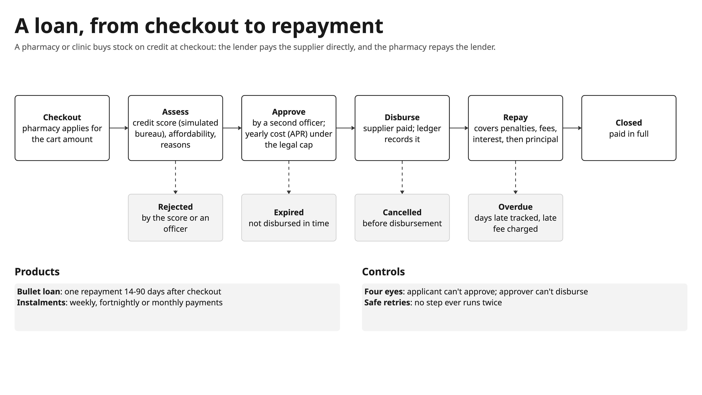

Application states:

<details>
<summary>Text version (Mermaid)</summary>

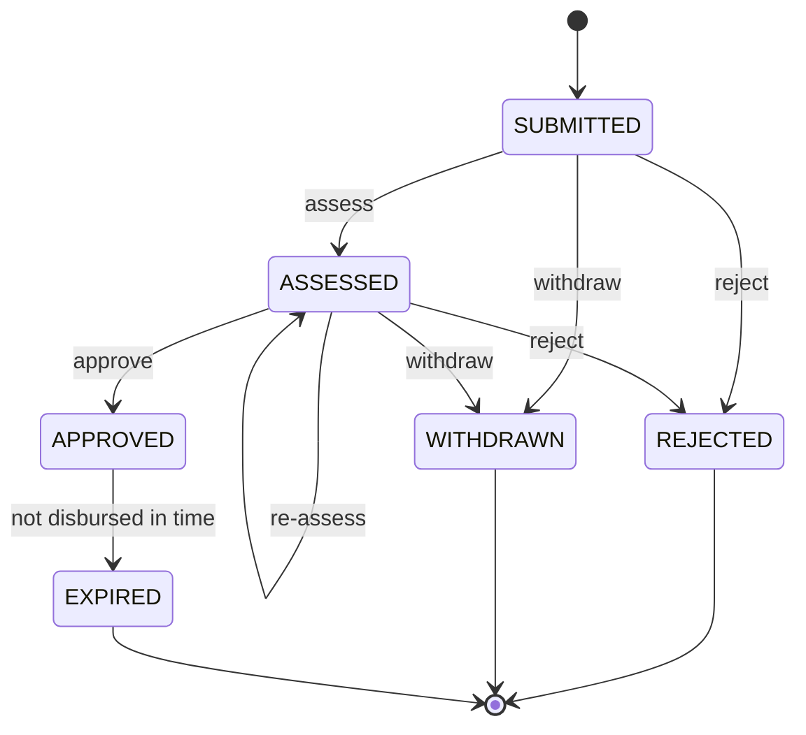

</details>

Approval creates a loan in `PENDING_DISBURSEMENT`. Loan states:

<details>
<summary>Text version (Mermaid)</summary>

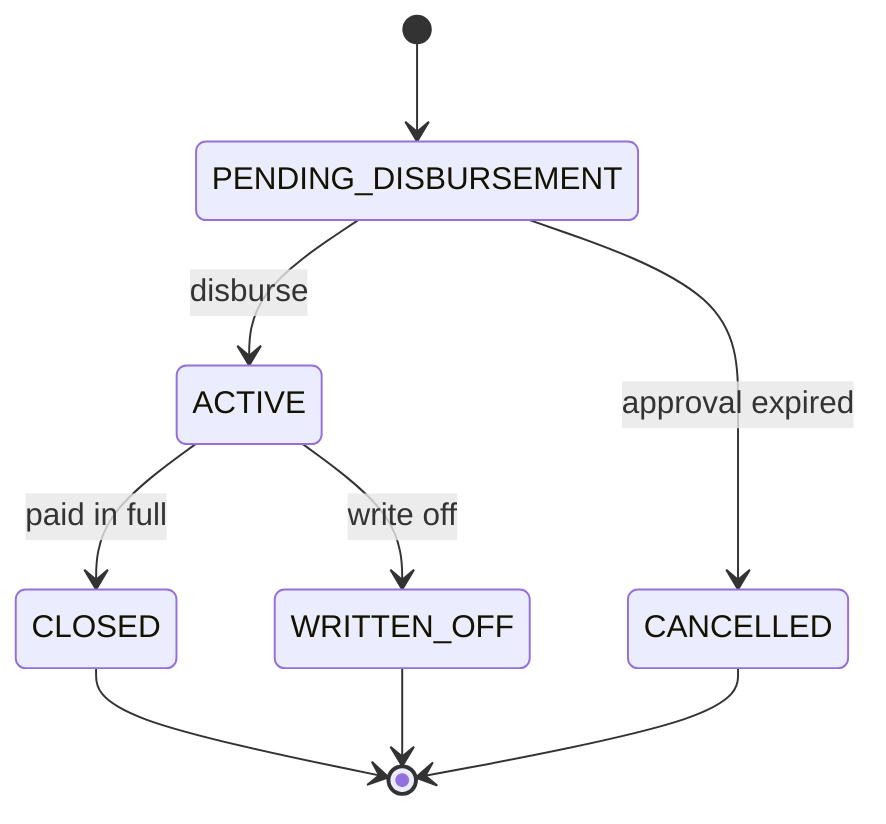

</details>

Being late is not a state. Days past due and a bucket (`CURRENT`, `DPD_1_30` … `DPD_90_PLUS`)
are derived and refreshed by end of day. An illegal move returns
`409 INVALID_STATE_TRANSITION`.

### Code layout

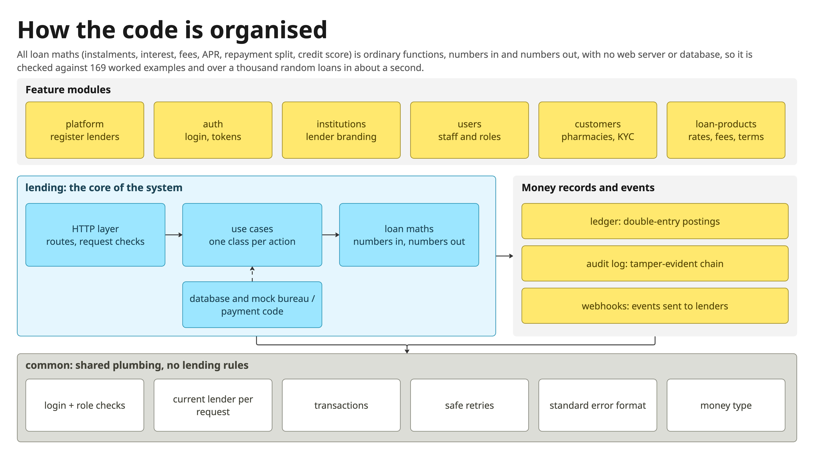

```text
src/
├── main.ts, worker.ts          API and worker entry points (same image)
├── config/                     environment schema (zod), validated at boot
├── common/                     cross-cutting plumbing, no business rules
│   ├── auth/                   AuthGuard, tokens, permissions, lockout, password hashing
│   ├── database/               Kysely, schema types, TransactionRunner (tenant-scoped transactions)
│   ├── idempotency/            Idempotency-Key interceptor
│   ├── audit/  outbox/         same-transaction audit and outbox writers
│   ├── money/  crypto/         bigint money, canonical JSON, HMAC, AES-256-GCM
│   ├── rate-limit/  redis/     layered rate limits
│   └── errors/  http/          RFC 9457 problem details, pagination, validation
├── modules/
│   ├── platform/               platform admins; register, list and suspend lenders
│   ├── directory/              tenant directory, 307 routing, slug reservations
│   ├── auth/                   staff and borrower login, refresh rotation, logout
│   ├── institutions/           lender profile and white-label branding, logo upload
│   ├── users/                  staff user management
│   ├── customers/              borrower self-registration, KYC (mock provider)
│   ├── loan-products/          versioned products, quotes
│   ├── lending/                core: domain (pure maths and rules), use cases, repositories, HTTP
│   ├── ledger/                 chart of accounts, posting rules, trial balance
│   ├── operations/             end-of-day service
│   ├── audit/                  audit queries and chain verification
│   ├── webhooks/               endpoints, outbox relay, signed delivery
│   └── health/                 liveness and readiness
├── worker/                     polling loops, end-of-day scheduler, directory reconcile
└── cli/                        seed, OpenAPI export
db/                             Flyway migrations, callbacks (roles), migrations image
test/                           db (integration) and e2e suites, fixtures, Testcontainers setup
infra/terraform/                AWS infrastructure
clients/white-label-web/        branded borrower app and back office
```

`src/modules/lending/domain` imports nothing from NestJS, Kysely or the network.

---

## Data model


Main tables (all in `db/migrations/V1__core_schema.sql`, plus V2–V5). Every table except the
platform-admin tables carries `tenant_id`.

<details>
<summary>Text version (Mermaid)</summary>

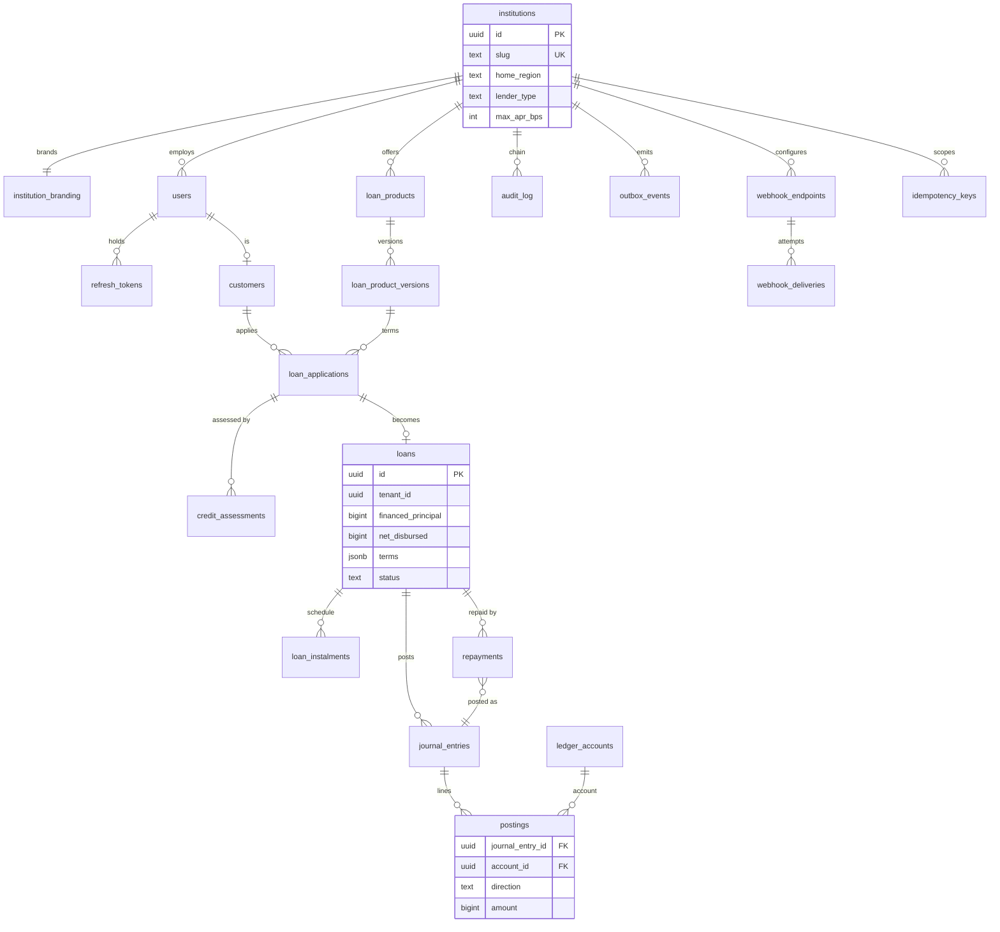

</details>

**Isolation and integrity rules, enforced by PostgreSQL:**

- **RLS is `ENABLE` + `FORCE`** on every tenant table. The policy is
  `tenant_id = current_setting('app.tenant_id')`, set per transaction. No tenant set means no
  rows.
- **Runtime roles are `NOBYPASSRLS`.** The API uses `lending_app`. The worker uses
  `lending_worker`, whose cross-tenant reach is an explicit `worker_all` policy visible in the
  schema. The API never holds worker credentials.
- **Tenants can only read their own `institutions` row** (V2). Status, slug, lender type and
  APR cap are platform-controlled.
- **Composite foreign keys `(tenant_id, id)`** stop a row from pointing at another lender's row,
  even through a bug. Unique constraints include `tenant_id`.
- **Append-only:** `journal_entries`, `postings`, `audit_log` and `loan_product_versions` reject
  `UPDATE`/`DELETE` by trigger, and the runtime roles have no such grants. `audit_log` also
  blocks `TRUNCATE`.
- **Balanced entries:** a deferred constraint trigger checks at commit that each journal entry
  has at least two postings, debits equal credits, and one currency. `postings.amount > 0`.
- **One of each:** one loan per application, one disbursement per provider reference, one
  journal entry per business reference (`idempotency_ref`).
- **Migrations** are plain SQL run by **Flyway** (`db/migrations/V<n>__name.sql`) as a
  non-superuser schema owner. Flyway callbacks create and rotate the two runtime roles
  (`db/callbacks/`). `make migrate` applies them; `make migrate-info` shows status.

---

## Lending model

**Products.** Each product has immutable versions; approval copies the terms onto the loan.

| Setting                       | Options                                                                                                                                     |
| ----------------------------- | ------------------------------------------------------------------------------------------------------------------------------------------- |
| Repayment                     | `BULLET` (one payment at maturity; term is tenor in days, simple interest ACT/365F) or instalments `DAILY`, `WEEKLY`, `BIWEEKLY`, `MONTHLY` |
| Interest method (instalments) | `REDUCING_BALANCE` (annuity), `FLAT`, `EQUAL_PRINCIPAL`                                                                                     |
| Rate                          | annual rate in basis points (2400 = 24.00 %)                                                                                                |
| Origination fee               | `NONE`, `FLAT` or `PERCENTAGE`; `DEDUCTED` (paid out = principal − fee) or `CAPITALISED` (financed = principal + fee)                       |
| Late fee                      | `NONE`, `FLAT` or `PERCENTAGE` of the overdue instalment, after `grace_days`, once per instalment                                           |
| Limits                        | min/max principal and term, max debt-to-income, min credit score, approval expiry days                                                      |
| Disbursement                  | `VENDOR` (pay the supplier, the default) or `BORROWER`                                                                                      |

- **APR** is the annualised internal rate of return of the borrower's real cash flows (net
  amount received, then each payment), using the Regulation Z Appendix J actuarial method
  (`src/modules/lending/domain/apr.ts`). **Total cost of credit** = total repayable − net
  disbursed. Both are shown before approval.
- **Usury cap.** Each lender has a platform-set `max_apr_bps`. Products and approvals above it
  are refused (`assertWithinAprCap`).

**Checkout orders** (`VENDOR` products). The applicant sends `externalOrderReference`; the
procurement platform (`CheckoutOrders` port) resolves it to the vendor, who is the only payee.

- Unknown order: `422 CHECKOUT_ORDER_NOT_FOUND`.
- Order placed by another customer: `422 ORDER_NOT_FOR_APPLICANT`.
- Principal above the order total: `422 ORDER_AMOUNT_EXCEEDED`.
- Order already behind a submitted, assessed or approved application of this lender:
  `409 ORDER_ALREADY_FINANCED` (unique index `loan_applications_order_once`). Rejecting,
  withdrawing or expiring the application frees the order.

- Order reference on a `BORROWER` product: `422 ORDER_REFERENCE_NOT_ALLOWED`.

The checks run in this order: not found, wrong buyer, amount, payee, single use. A refused
application never reserves the order. The buyer and total checks run only when the adapter
attests them. The mock does not.

**Credit assessment** (mock, versioned `scorecard-v1`, `src/modules/lending/domain/credit/`):

1. Knock-outs: KYC not verified, owner age outside 18–65, an existing loan at this lender more
   than 30 days past due.
2. Mock bureau: a deterministic score of 300–850 derived by HMAC from the borrower's hashed
   national id, plus a delinquency flag.
3. Affordability: debt-to-income (existing monthly debt + this loan's monthly equivalent, over
   monthly income) must not exceed the product's `max_dti_bps`.
4. Scorecard points give a grade A–E and a decision: `APPROVE`, `REFER`, `DECLINE` or
   `COUNTER_OFFER` (the largest principal the borrower can afford).
5. Reason codes `R01_DTI_ABOVE_THRESHOLD` … `R08_BELOW_MIN_SCORE` explain the result. All
   inputs are stored on `credit_assessments` so a decision can be reproduced.

**Repayments** are recorded by finance staff only (borrowers cannot self-attest payment).

- Allocation is **oldest instalment first**, and within an instalment
  **penalties → fees → interest → principal** (`src/modules/lending/domain/waterfall.ts`).
- **Payoff** = outstanding principal + unpaid interest due so far + outstanding fees and
  penalties. Interest on instalments not yet due (after business today) is waived. Paying
  exactly the payoff closes the loan; paying more is `422 REPAYMENT_EXCEEDS_PAYOFF`.
- The value date may be at most `REPAYMENT_MAX_BACKDATE_DAYS` (default 3) before today, never
  before the latest recorded repayment nor in the future (`422 VALUE_DATE_OUT_OF_RANGE`);
  every channel except `CASH` needs a unique `externalReference`.

**End of day** closes a business date once it is over: at `EOD_RUN_AT_LOCAL_TIME` (default
00:05) in the lender's own time zone the worker runs it for the PREVIOUS local date, retrying on
later ticks until no loan was skipped or failed; or on demand with
`POST /v1/operations/end-of-day`. Re-running a date posts nothing twice, and an approval is
never expired before its `expiresAt`. For each loan, in its own transaction:

- recognise interest on instalments due on or before the date;
- charge the late fee once on instalments still owing after the grace period;
- refresh days past due and the bucket;
- expire approvals not disbursed in time (application `EXPIRED`, loan `CANCELLED`).

**Ledger postings** (per lender, per currency; `src/modules/ledger/domain/posting-rules.ts`):

| Event                             | Debit                                   | Credit                                   |
| --------------------------------- | --------------------------------------- | ---------------------------------------- |
| Disbursement, fee deducted        | 1100 Loan principal receivable: P       | 1000 Cash: P − fee; 4100 Fee income: fee |
| Disbursement, fee capitalised     | 1100 Loan principal receivable: P + fee | 1000 Cash: P; 4100 Fee income: fee       |
| Interest recognised               | 1110 Interest receivable                | 4000 Interest income                     |
| Interest waived after recognition | 4000 Interest income                    | 1110 Interest receivable                 |
| Late fee                          | 1130 Penalty receivable                 | 4200 Penalty income                      |
| Repayment of X                    | 1000 Cash: X                            | 1130, 1120, 1110, 1100 as allocated      |

`GET /v1/ledger/trial-balance` shows the balances; `GET /v1/loans/{id}/ledger` shows one loan.
Corrections are new reversing entries, never edits.

---

## Security

| Threat                            | Control                                                                                                                                                                                                                                                                                                                       |
| --------------------------------- | ----------------------------------------------------------------------------------------------------------------------------------------------------------------------------------------------------------------------------------------------------------------------------------------------------------------------------- |
| One lender reading another's data | RLS in PostgreSQL with `FORCE`, `NOBYPASSRLS` roles, composite foreign keys; tenant id only from the verified token; cross-lender ids return `404`, never `403`                                                                                                                                                               |
| Broken authentication             | 15-minute HS256 JWTs with pinned algorithm, audience and `cell` claim; refresh tokens rotated on every use, reuse revokes the family; argon2id passwords; uniform login errors; lockout after 5 failures for 15 minutes                                                                                                       |
| Privilege misuse                  | Deny-by-default guard; a tenant route without a declared permission is rejected; **maker-checker**: the submitter cannot decide, the approver cannot disburse (`403 SOD_VIOLATION`); borrowers see only their own records                                                                                                     |
| Replayed or duplicated requests   | `Idempotency-Key` required on create application, approve, disburse and repayment; key, business write and stored response commit in one transaction; database unique constraints as the last line                                                                                                                            |
| Tampering with money or history   | Append-only ledger and audit tables; balanced-entry trigger; per-lender SHA-256 hash chain over RFC 8785 canonical JSON; `GET /v1/audit-logs/verify` recomputes it                                                                                                                                                            |
| Abuse and noisy neighbours        | AWS WAF per-IP rules at the edge; in the app, Redis-backed budgets per principal (300/min), per lender for **staff** (3000/min) and separately for **customers** (1500/min), per anonymous IP (60/min), credential endpoints per IP (20/min), sign-ups per lender (30/hour); `429` with `Retry-After` and `RateLimit` headers |
| SSRF through webhook URLs         | HTTPS only, no userinfo; DNS result must be a public unicast address (allow-list), checked at registration and again at delivery with the IP pinned                                                                                                                                                                           |
| Stored XSS via logos              | Raster logos only (PNG, JPEG, WebP); upload keys bound to the lender's own S3 prefix                                                                                                                                                                                                                                          |
| Leaked secrets                    | Secrets from AWS Secrets Manager in the cloud; `.env` values are local-only; webhook secrets encrypted with AES-256-GCM bound to their row                                                                                                                                                                                    |
| Personal data exposure            | BVN/NIN stored only as HMAC-SHA256 + last 4 digits; logs redact tokens, passwords and national ids; audit entries redact secrets and mask email, phone and account numbers before hashing                                                                                                                                     |

Errors use RFC 9457 `application/problem+json` and never include stack traces.

---

## Technical decisions

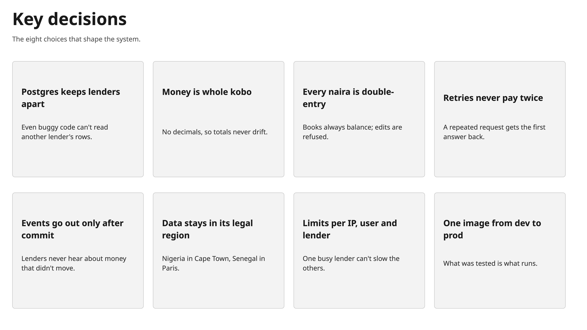

| Decision                                           | Why                                                                                                                 | Alternatives considered                                                            |
| -------------------------------------------------- | ------------------------------------------------------------------------------------------------------------------- | ---------------------------------------------------------------------------------- |
| First region **af-south-1** (Cape Town), as a cell | Only parent region of the AWS Lagos Local Zone (path to in-country data); lowest latency from Lagos                 | eu-west-3, eu-west-1, eu-west-2 (no Lagos path, slower); Nigerian colocation       |
| **Pool tenancy + RLS**                             | One schema to run; isolation enforced by the database, not only app code                                            | App-level filters only; schema per tenant; database per tenant                     |
| **Kysely** query builder                           | Typed SQL with no hidden queries; RLS, triggers and policies stay in SQL                                            | Prisma, TypeORM, Drizzle, Knex, MikroORM                                           |
| **Flyway** SQL migrations                          | Plain SQL, checksums, refuses edited migrations; same image in tests and prod                                       | Liquibase, dbmate, node-pg-migrate, Prisma Migrate, Kysely `Migrator`              |
| **bigint minor units** (kobo) + banker's rounding  | No floating-point loss; half-even rounding avoids bias; JSON amounts are strings                                    | JS numbers or floats; JSON numbers; half-up rounding; Dinero.js                    |
| **Double-entry ledger** in PostgreSQL              | Every naira traceable; balance checked by the database at commit                                                    | Balance columns on loans; app-only checks; external ledger (TigerBeetle, Formance) |
| **Atomic idempotency**                             | Key, business write and response commit together; no double execution window                                        | Unique constraints only; Redis keys; reserve and store in separate transactions    |
| **Outbox → SQS → webhooks**                        | Events never lost or sent for rolled-back writes; retries and DLQ from SQS                                          | Publish inside the request; synchronous webhooks; Debezium CDC; EventBridge        |
| **Cells + DynamoDB directory**                     | Each lender's data in its legal region; local directory reads in every cell                                         | One region for all; Aurora Global directory; DNS record per tenant; central router |
| **Layered rate limiting**                          | Edge stops floods; app limits per principal and per lender stop noisy neighbours                                    | WAF only; in-process only; API Gateway usage plans; custom Lua                     |
| **ECS Fargate**                                    | No servers to patch; fits one image, two processes                                                                  | EKS, App Runner, Lambda, EC2                                                       |
| **Libraries over hand-rolled code**                | Vetted code for JWT, argon2, rate limits, webhook signing, canonical JSON; hand-write only lending maths and ledger | Hand-roll everything; libraries for everything, incl. lending maths                |

**Latency from Lagos** (2026-11-06, `curl` TCP connect to `dynamodb.<region>.amazonaws.com`,
5 samples, median; one ISP, Airtel):

| Region       | Location    | Median TCP connect          |
| ------------ | ----------- | --------------------------- |
| af-south-1   | Cape Town   | **78 ms**                   |
| eu-west-2    | London      | 120 ms                      |
| eu-west-3    | Paris       | 129 ms                      |
| eu-central-1 | Frankfurt   | 136 ms                      |
| eu-south-1   | Milan       | 138 ms                      |
| eu-west-1    | Ireland     | 150 ms                      |
| me-central-1 | UAE         | 223 ms                      |
| us-east-1    | N. Virginia | probe failed (not measured) |

Independent ICMP probes (Globalping, 5 packets, average round trip):

| Vantage                            | af-south-1 | eu-west-2 | eu-west-3 | eu-west-1 | eu-central-1 |
| ---------------------------------- | ---------- | --------- | --------- | --------- | ------------ |
| **Lagos, NG** (3 networks, median) | **56 ms**  | 98 ms     | 102 ms    | 105 ms    | 106 ms       |
| Ouagadougou, BF (BFIX)             | 78 ms      | 132 ms    | 128 ms    | 141 ms    | 130 ms       |
| Cotonou, BJ (ISOCEL)               | 246 ms     | 107 ms    | 100 ms    | 116 ms    | 109 ms       |

One HTTPS request costs about three round trips, so the gap per cold request is roughly
three times these differences. Other West African routes vary by carrier, which is one reason
Senegalese lenders get their own cell.

---

## Testing

**Tools:** Vitest 5 (runner), supertest (HTTP), Testcontainers (real PostgreSQL 16, Redis 7,
LocalStack and the Flyway image in Docker), fast-check (property tests, for example "the
schedule's principal always sums to the loan amount"), `@vitest/coverage-v8`.

| Project | Scope                                                                    | Runs against                                                                           | Tests           |
| ------- | ------------------------------------------------------------------------ | -------------------------------------------------------------------------------------- | --------------- |
| `unit`  | `src/**/*.spec.ts`, pure logic next to the code                          | nothing                                                                                | 441 in 43 files |
| `db`    | `test/integration/**`: RLS, ledger, audit, privileges, Flyway guarantees | a PostgreSQL container per suite, migrated by the real Flyway image as a non-superuser | 32              |
| `e2e`   | `test/e2e/**`: HTTP journeys through the real app                        | PostgreSQL + Redis + LocalStack (S3, SQS, DynamoDB)                                    | 167             |

```bash
make test-unit              # no Docker needed
make test                   # all three projects (Node 24 + Docker)
make test-docker            # the same suite inside a container (Docker only)
make coverage               # with the coverage gate; report in coverage/
make check                  # lint + typecheck + unit tests
```

**Coverage gate** (CI fails below it): 80 % lines, 75 % branches, 80 % functions, 80 %
statements overall; 95 / 90 / 95 / 95 for `src/modules/lending/domain/**`.

---

## Infrastructure

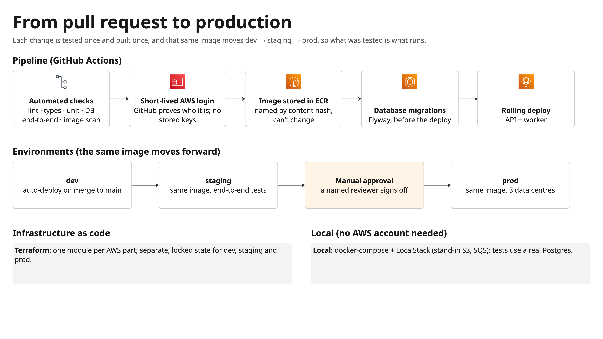

Terraform lives in `infra/terraform/` (details: [infra/terraform/README.md](infra/terraform/README.md)).

| Folder                                | Contents                                                                                                                                                                         |
| ------------------------------------- | -------------------------------------------------------------------------------------------------------------------------------------------------------------------------------- |
| `bootstrap/`                          | state bucket and KMS key, GitHub OIDC, per-environment CI roles and permission boundaries                                                                                        |
| `global/`                             | global control plane: DynamoDB tenant directory and Route 53 routing                                                                                                             |
| `modules/`                            | `network`, `security` (KMS, WAF, secrets), `database`, `cache`, `messaging`, `storage`, `ecr`, `ecs-service`, `alb`, `observability`, `directory`, `edge`, `platform` (one cell) |
| `environments/dev`, `staging`, `prod` | thin roots with sizing; each has its own state key                                                                                                                               |
| `environments/local`                  | LocalStack target built from the same modules (`make tf-local`)                                                                                                                  |

- State uses the S3 backend with S3-native locking (`use_lockfile`), no DynamoDB lock table.
- **Apply order:** enable the af-south-1 opt-in region → apply `bootstrap/` once by hand →
  per environment, `terraform init` with the state bucket and `terraform apply`. Releases run the
  Flyway migrate task first and wait for exit code 0, then roll the API and worker.
- The same image digest is promoted dev → staging → prod. Prod apply needs a GitHub Environment
  approval.

**CI gates.** `.github/workflows/ci.yml`: lint, typecheck, format check; unit tests; db and e2e
tests; coverage gate; `npm audit` (production dependencies, high and above); hadolint; build
both images and Trivy-scan them (fail on HIGH/CRITICAL). `.github/workflows/infra.yml`:
`terraform fmt`, `validate`, `terraform test` (bootstrap CI roles, messaging, storage,
ecs-service, directory, security, platform, database, cache, edge), tflint, checkov (all
without cloud credentials), a reviewer-gated read-only plan (`plan` Environment), and
main-only, approval-gated applies.

---

## Evidence

Screenshots are stored in `assets/evidence/`. Each one comes from a run against the local stack
(`make up PROFILES=two-cells && make seed-all`); tokens and passwords are redacted.

### Branded app: Eko MediCredit

Home and checkout themed only by the branding API: colours, logo, `en-NG` and NGN with 2 decimals.

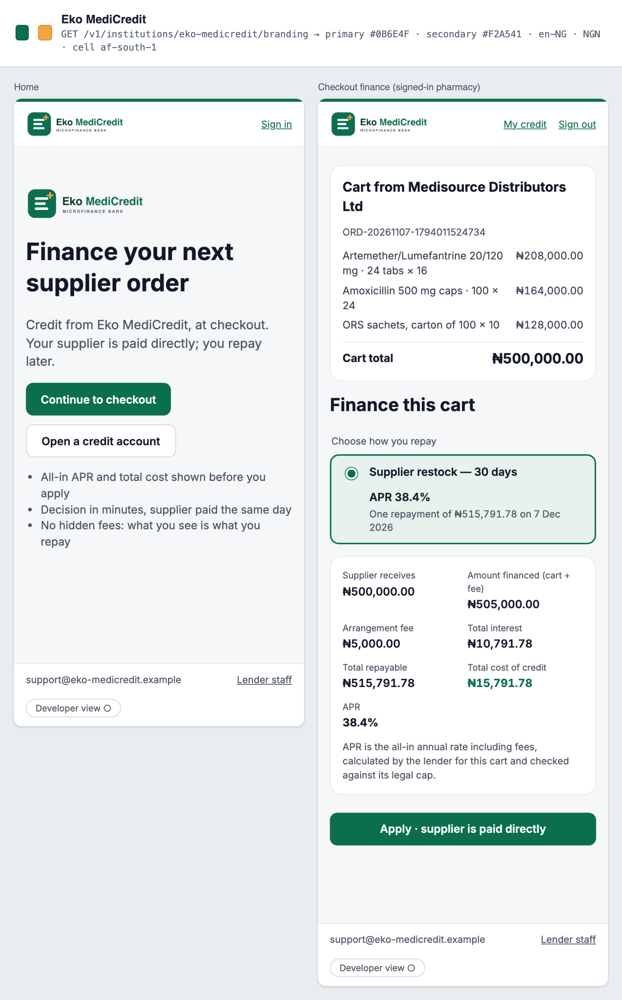

### Branded app: Arewa PharmaFinance

The same screens with Arewa PharmaFinance branding from its own branding response.

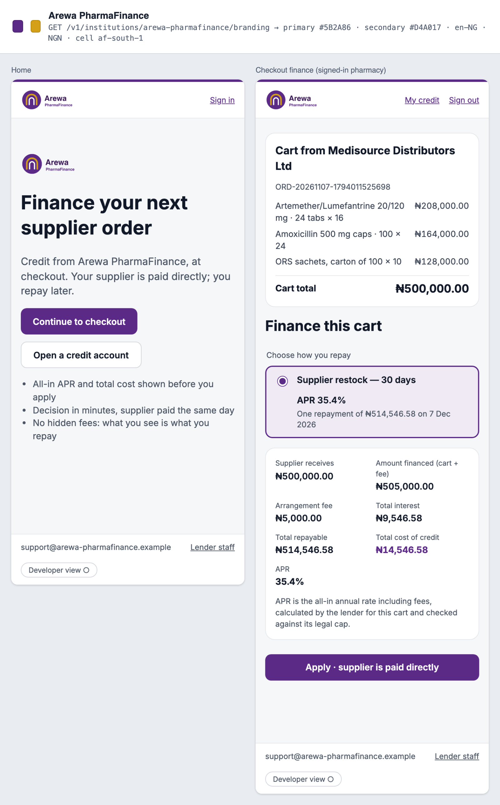

### Branded app: Delta CareLend

The same screens with Delta CareLend branding from its own branding response.

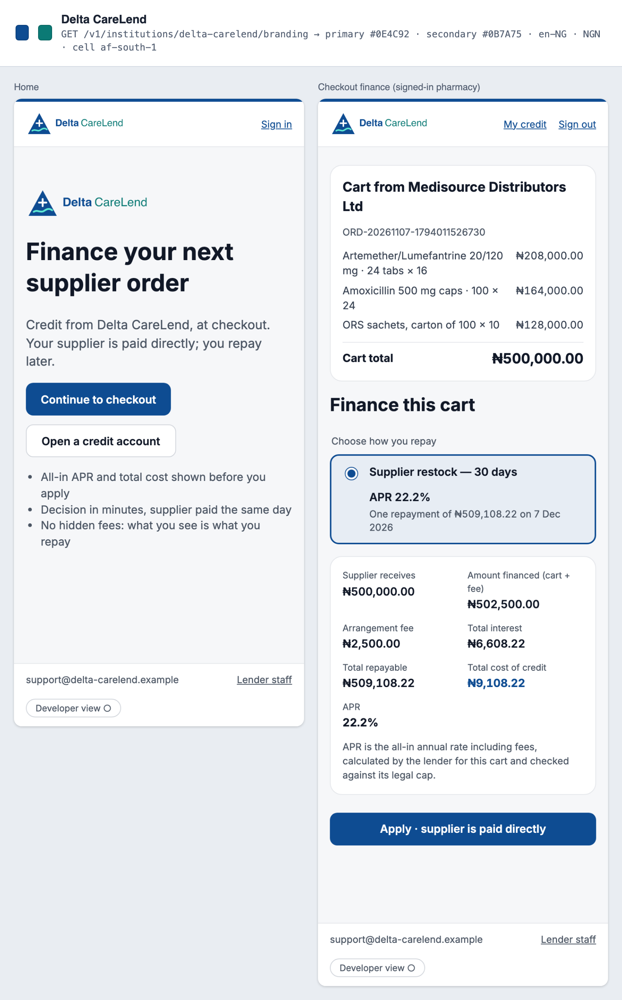

### Branded app: Teranga Santé (eu-west-3)

The EU lender, served by the eu-west-3 cell, in French (`fr-SN`) with XOF and no decimals.

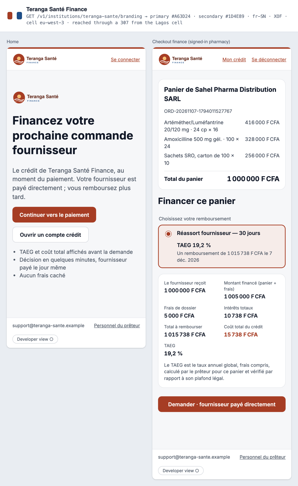

### Back-office credit assessment with reason codes

A credit officer runs the scorecard: a counter-offer with reason code R01 and the maximum affordable amount.

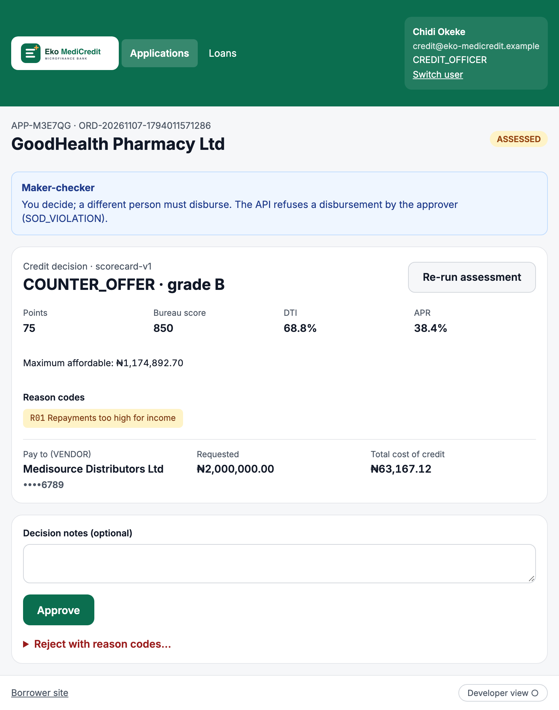

### Maker-checker: approver cannot disburse (403)

A credit officer cannot disburse, and the person who approved a loan still cannot disburse it after moving to finance (`SOD_VIOLATION`).

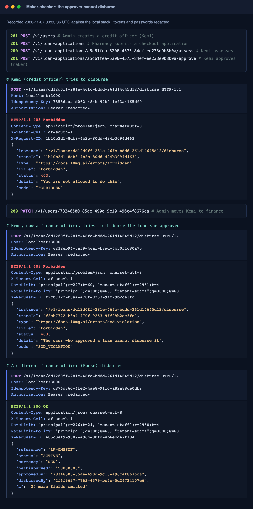

### Cross-lender access returns 404

Staff of one lender get 404 for another lender's loan and application, so nothing reveals that the record exists.

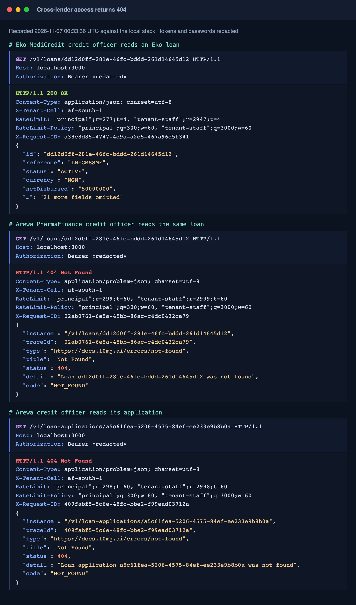

### Idempotent replay (`Idempotent-Replayed: true`)

The Developer view resends a disbursement with the same `Idempotency-Key`: the stored response is replayed and nothing is paid twice.


### Ledger trial balance balances

After the disbursements, total debits equal total credits in the trial balance.

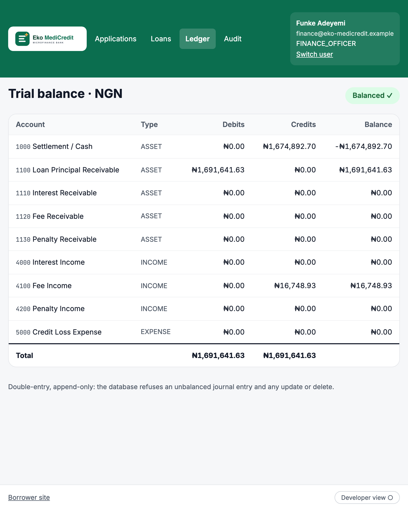

### Audit chain verified

The finance officer verifies the hash-chained audit log for the lender.

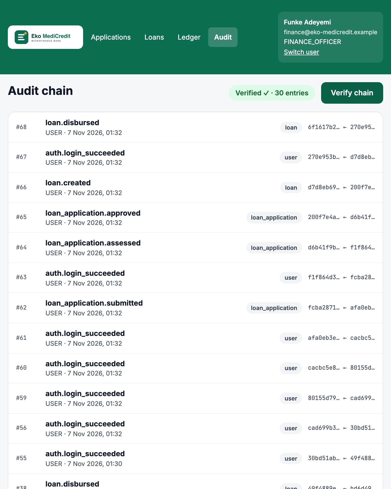

### Cross-region login answered with 307

A login for the EU lender sent to the Lagos cell gets 307 `WRONG_CELL` with the EU cell as `Location`; repeating it there succeeds.

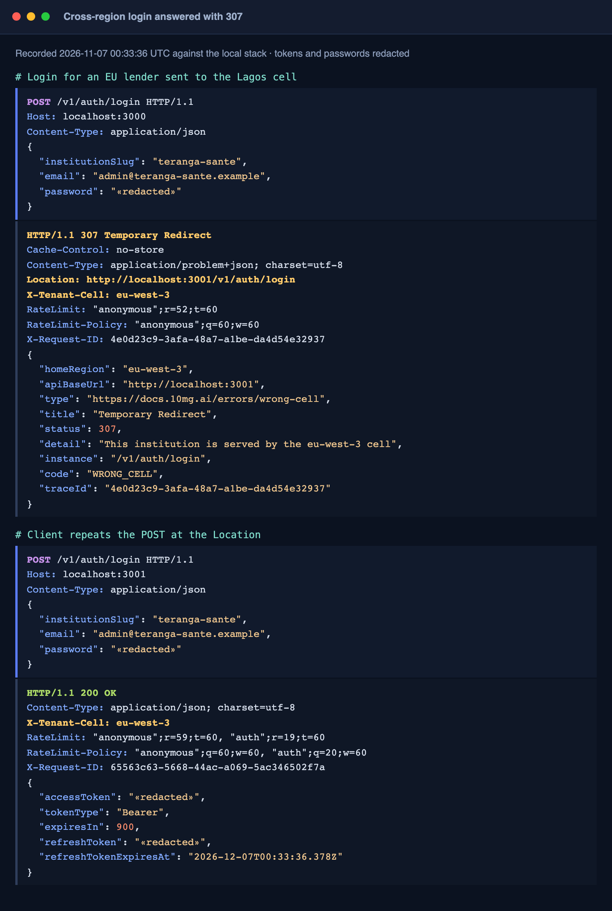

### Rate limit reached (429)

Repeated sign-ins from one client exhaust the sign-in budget and get 429 with `Retry-After` and `RateLimit` headers.

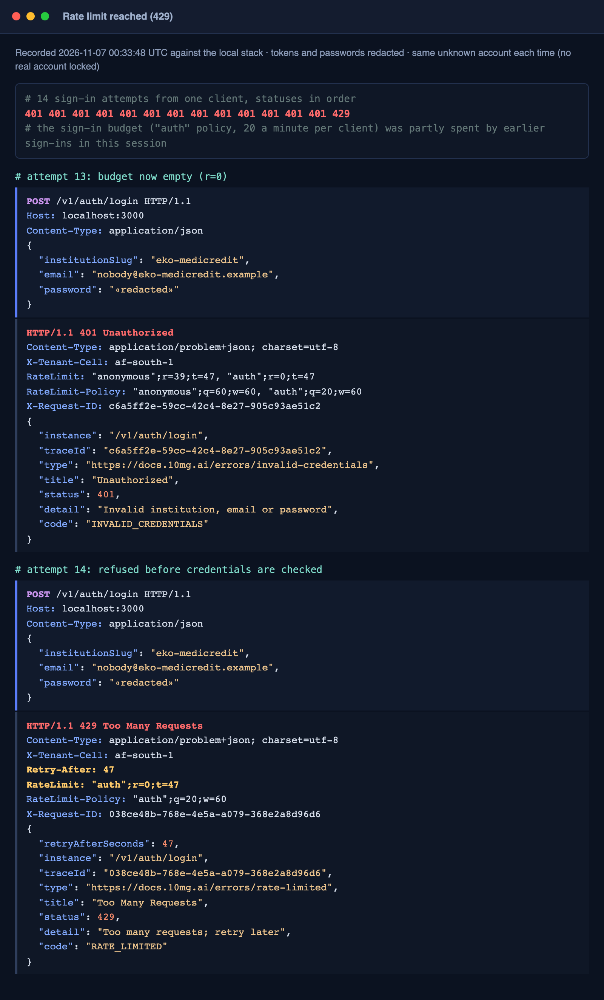

### Signed webhook received and verified

The worker delivers `loan.disbursed` over HTTPS with Standard Webhooks headers; the receiver verifies the signature and rejects a tampered body.

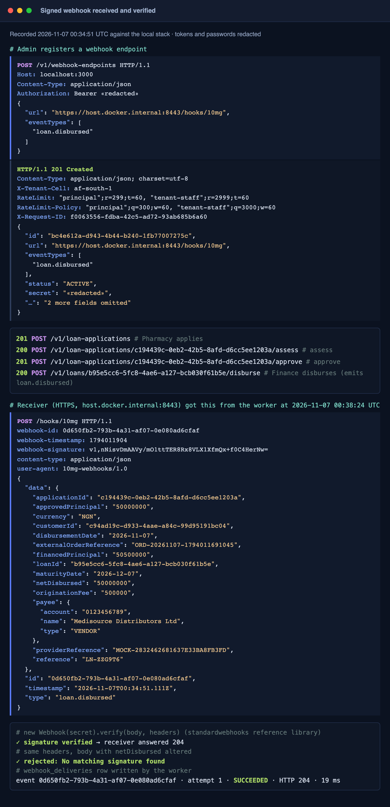

### Tests and coverage green

Unit, database and end-to-end suites pass with coverage above the gate, plus the web client tests.

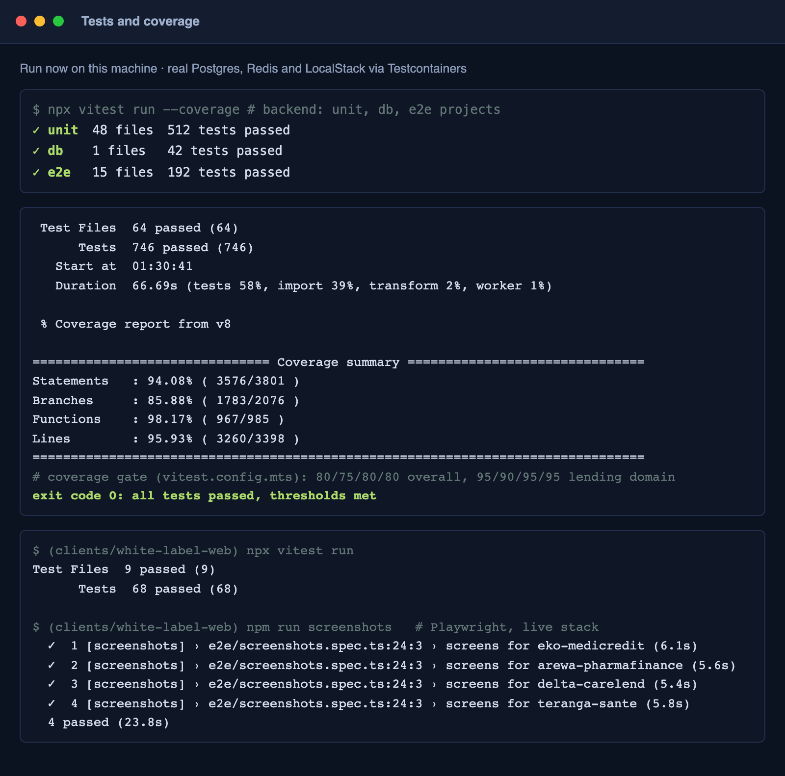

---

## Limitations and next steps

- **Mock providers.** KYC (`src/modules/customers/kyc.ts`), credit bureau and payment gateway
  are deterministic mocks behind ports. The KYC mock is refused in production. Real providers
  plug in behind the same interfaces.
- **Checkout order attestation.** The mock procurement platform returns only the vendor, so
  today nothing binds an order to its buyer or caps the principal at the order total. A real
  adapter must return both (`buyerCustomerId`, `total`); tests use a strict fake that does.
  So in the demo any customer of a lender can still reserve (squat) a `VENDOR` order another
  pharmacy placed and block its real checkout with `409 ORDER_ALREADY_FINANCED`. A real
  procurement adapter that attests the buyer closes this.
- **Borrower-initiated repayments** need payment intents: pending until a verified provider
  callback, then allocated and posted. Today only finance staff record repayments.
- **Disbursement with a real provider** must be two-phase (pending → confirmed by callback),
  not a network call inside the database transaction as the mock does.
- **Global slug uniqueness** relies on a conditional-write reservation in the DynamoDB global
  table. Global tables replicate asynchronously, so two cells reserving the same slug at the
  same moment is not fully ruled out.
- **Audit anchoring.** The hash chain detects edits but not a full rewrite by someone with
  database owner rights. Next: sign chain heads with an HMAC or KMS key and anchor them in S3
  with Object Lock.
- **Write-off** is modelled in the state machine and chart of accounts (5000 Credit loss
  expense) but has no API or posting yet.
- **Revolving credit lines** per pharmacy (limits, draws, utilisation). Bullet loans are the
  building block.
- **FX.** Each journal entry has one currency; there is no currency conversion.
- **Interest accrual** is recognised on each due date, not daily on an effective-interest
  basis. Daily accrual is needed for month-end reporting.
- **Lagos in-country data cell.** Nigerian payment data inside the Lagos Local Zone (EC2 +
  self-managed PostgreSQL in the af-south-1 VPC) once the CBN rule is confirmed to apply.

---

## References

**Frameworks and tools**

- NestJS documentation: <https://docs.nestjs.com/>
- Kysely documentation: <https://kysely.dev/>
- Flyway documentation: <https://documentation.red-gate.com/flyway>
- Vitest: <https://vitest.dev/> · fast-check: <https://fast-check.dev/>
- Testcontainers for Node.js: <https://node.testcontainers.org/>
- LocalStack documentation: <https://docs.localstack.cloud/>
- Terraform S3 backend (`use_lockfile`): <https://developer.hashicorp.com/terraform/language/backend/s3>
- Terraform tests: <https://developer.hashicorp.com/terraform/language/tests>

**Databases and AWS**

- PostgreSQL 16, Row Security Policies: <https://www.postgresql.org/docs/16/ddl-rowsecurity.html>
- AWS Prescriptive Guidance, RLS for multi-tenant PostgreSQL: <https://docs.aws.amazon.com/prescriptive-guidance/latest/saas-multitenant-managed-postgresql/rls.html>
- AWS SaaS Lens: <https://docs.aws.amazon.com/wellarchitected/latest/saas-lens/saas-lens.html> ·
  cell-based architecture: <https://docs.aws.amazon.com/wellarchitected/latest/saas-lens/cell-based-architecture.html>
- AWS Well-Architected Framework: <https://docs.aws.amazon.com/wellarchitected/latest/framework/welcome.html>
- AWS Local Zones locations (Lagos): <https://aws.amazon.com/about-aws/global-infrastructure/localzones/locations/>

**Security**

- OWASP API Security Top 10 (2023): <https://owasp.org/API-Security/editions/2023/en/0x11-t10/>
- OWASP Password Storage Cheat Sheet: <https://cheatsheetseries.owasp.org/cheatsheets/Password_Storage_Cheat_Sheet.html>
- OWASP Authentication Cheat Sheet: <https://cheatsheetseries.owasp.org/cheatsheets/Authentication_Cheat_Sheet.html>
- RFC 9700, OAuth 2.0 Security Best Current Practice (refresh token rotation): <https://www.rfc-editor.org/rfc/rfc9700>

**HTTP and data standards**

- RFC 9457, Problem Details for HTTP APIs: <https://www.rfc-editor.org/rfc/rfc9457>
- RFC 9110, HTTP Semantics (307, 421): <https://www.rfc-editor.org/rfc/rfc9110>
- RFC 8785, JSON Canonicalization Scheme: <https://www.rfc-editor.org/rfc/rfc8785>
- IETF draft, The Idempotency-Key HTTP Header Field: <https://datatracker.ietf.org/doc/draft-ietf-httpapi-idempotency-key-header/>
- IETF draft, RateLimit header fields (-11): <https://datatracker.ietf.org/doc/html/draft-ietf-httpapi-ratelimit-headers-11>
- Standard Webhooks specification: <https://www.standardwebhooks.com/>
- Stripe, idempotent requests: <https://docs.stripe.com/api/idempotent_requests>
- ISO 4217 currency codes: <https://www.iso.org/iso-4217-currency-codes.html>

**Lending and regulation** (summarised; verify with counsel)

- Regulation Z, Appendix J (APR actuarial method): <https://www.consumerfinance.gov/rules-policy/regulations/1026/j/>
- Central Bank of Nigeria, circular on data localisation in the Nigeria payments system
  (15 June 2026): <https://www.cbn.gov.ng/>
- FCCPC, Digital, Electronic, Online or Non-Traditional Consumer Lending Regulations 2025:
  <https://fccpc.gov.ng/>
- BCEAO / UMOA usury rates (Decision 19/29-12-2025/CM/UMOA): <https://www.bceao.int/>
- Nigeria Data Protection Act 2023 (NDPC): <https://ndpc.gov.ng/>
